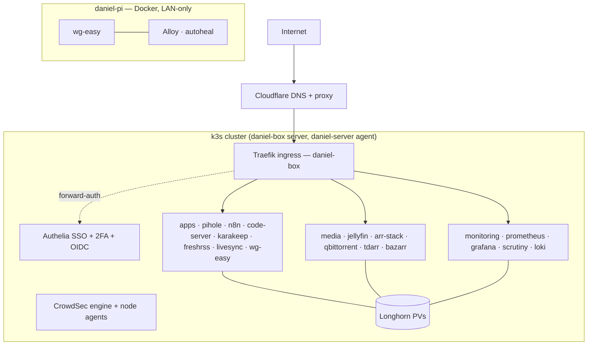

# Server Homelab

A **k3s** homelab managed as infrastructure-as-code with **Ansible**, with a small residual
**Docker** footprint on the Pi. Services are fronted by **Traefik** with **Authelia** SSO,
secrets encrypted with **SOPS/age**, storage on **Longhorn**, and reverse-proxied behind
**Cloudflare**.

<!-- The exact count is whatever `containers_list` says in inventory/host_vars/*.yml — don't
     restate a precise number here or in CLAUDE.md; two hand-maintained copies drift apart
     (they read 44 and 49 while the real total was 52). -->

```bash
grep -c '^  - name:' ansible/inventory/host_vars/*.yml   # the actual per-host tally
```

> Day-to-day conventions and the agent contract live in [`CLAUDE.md`](CLAUDE.md). Most
> directories and many roles have their own `CLAUDE.md` with role-specific notes.

The migration from Docker Compose to k3s completed on **2026-08-14**, when Docker was
uninstalled from `daniel-server`. The slice-by-slice record is in
[`docs/archive/k3s-migration/`](docs/archive/k3s-migration/) — those documents are historical and describe
work already executed.

## Hosts

| Host | Role | Notes |
|------|------|-------|
| `daniel-box` | k3s server (control plane) | Runs almost every workload. Traefik edge, Authelia SSO + OIDC issuer, Pi-hole DNS, Longhorn storage, CrowdSec. Internet-exposed via Cloudflare, and the **public WireGuard endpoint** (wg-easy, 51820/udp — the router forward moved here). `homelab-checkout-sync` keeps its primary checkout at `origin/master`. |
| `daniel-server` | k3s agent node | Intel XE iGPU (Jellyfin/Tdarr transcode), LVM storage, UPS hardware + the NUT shutdown chain. **Docker uninstalled 2026-08-14** — it hosts no Compose services. |
| `daniel-pi` | Raspberry Pi — Docker | **LAN-only**, never internet-exposed or on the tunnel. A second, LAN-only wg-easy (51822/udp) + a small utility stack (Glances, autoheal, docker-proxy). The only remaining Docker host. |

## Repository layout

```
ansible/          # Render inputs for the k8s roles; no playbook   ← EDIT HERE
  roles/k8s/          # One role per k8s workload (manifests rendered from templates)
  templates/          # Shared Jinja partials the k8s roles include
  filter_plugins/     # Custom Jinja filters (toposort.py)
  inventory/          # group_vars/all.yml, host_vars/<host>.yml (one file per host)
  vars/secrets.yml    # SOPS-encrypted secrets
  tests/              # Tests over the roles, their renders and the deploy path
cluster/          # services.yml: one entry per k8s deploy tag
hosts/            # Host packages and the setup plane each one ships
  components/         # Units, timers and scripts a host package installs; the Pi's
                      #   Docker services are pi-compose/
  daniel-box/ …       # One package.yml per host
  packages/           # Packages shared across hosts
  lib/                # The updater, reconcile and checkout-sync helpers
  bootstrap-host.sh   # One-time bring-up of a new host
scripts/          # Renderer, landing, diagnostics and docs generators
evals/            # Evals of the Claude Code setup
docs/             # Runbooks, design specs, security notes
  reference/          # Generated reference pages; never hand-edited
  archive/            # Superseded planning docs (incl. the Docker → k3s migration)
```

**The Pi's rendered Compose project is not in this repo.** The `homelab-daniel-pi` package
installs it at `/usr/lib/homelab/compose/` on `daniel-pi`, the only Docker host; neither
cluster node runs Docker. Edits there are overwritten by the next package version: always
change `hosts/components/pi-compose/services/<svc>/` instead. The cluster's equivalent is the
manifests rendered from `ansible/roles/k8s/`.

## Ingress and segmentation

Traefik is the single ingress on `daniel-box`, routing to workloads via Traefik
`IngressRoute` CRDs; Authelia gates protected routes via forward-auth middleware and issues
OIDC tokens for apps that speak it. Cloudflare proxies the public hostnames; `*.local.<domain>`
names are resolved by Pi-hole on the LAN and are not exposed.



Network segmentation is **not** blanket-enforced: only a few roles define NetworkPolicies
(`n8n`, `prowlarr`, `registry`) — everything else is reachable pod-to-pod within the
namespace. Where policies do exist, **ingress** rules are enforced; **egress** rules are
**not** enforced by this cluster's CNI, so never read an egress policy as a control.

## How deploys work

A k3s workload deploys through `promote` and Flux once its PR merges. No script deploys a
workload by hand.

- **The render** — `homelab_render.py` orders `roles/k8s/<name>` with `build_k8s_dep_map` /
  `toposort_containers` (`ansible/filter_plugins/toposort.py`, unit-tested in
  `ansible/tests/deploy/test_toposort.py`). A role rendering a Traefik CRD gets an edge onto
  `traefik`, which installs the CRDs every later `IngressRoute` depends on; `use_authelia: true` gets one onto
  `authelia`, which creates the middleware other routes reference. Both are derived from the
  role's own templates/entry, not hand-listed; an edge no template carries (crowdsec before
  traefik, for the LAPI machine credential) is declared as `depends_on:` on the entry instead.
  List order in `cluster/services.yml` is only the sort's tiebreak.

- **The Pi's containers** are `compose_services` entries that its `homelab-daniel-pi` package
  deploys. No host lists a Docker `containers_list` entry:
  `scripts/validate/compose_templates.py:undeployed_docker_entries` refuses one. The Pi's
  ordering, docker-proxy before autoheal and alloy, is each service file's `depends_on`, and
  `ansible/tests/deploy/test_platform_filter_real_inventory.py` pins it.

No playbook brings a host up. `hosts/bootstrap-host.sh` does, and `docs/host-packages.md`
(*Rebuilding daniel-box*, *Rebuilding daniel-server*) and `docs/break-glass.md` (the Pi runbook)
order the steps. A host's setup plane ships in its host package. The manual post-deploy setup
that no package can do is verified by
`uv run python scripts/diagnostics/postflight.py`.

## Cross-cutting systems

- **Secrets** — `ansible/vars/secrets.yml`, encrypted with SOPS + age (`.sops.yaml`
  auto-encrypts anything under `vars/`/`secrets/`). Decrypted at runtime via the
  `community.sops` lookup. Edit with `sops ansible/vars/secrets.yml`. **Never commit
  plaintext secrets** — gitleaks runs pre-commit. The age private key is backed up
  out-of-band (single point of recovery).
- **Observability** — the Prometheus / Grafana / Loki / Tempo stack runs in-cluster from
  `ansible/roles/k8s/observability/`, alongside `roles/k8s/loki-homelab` (Loki + an Alloy
  DaemonSet) for homelab logs. Prometheus scrapes node-exporter / cAdvisor / Traefik /
  CrowdSec. Grafana dashboards stay provisioned as code from
  [`roles/k8s/observability/files/dashboards/`](ansible/roles/k8s/observability/files/dashboards/) — that
  tree is the single source of truth and is mounted into the cluster Grafana, which is why
  the role survives the migration despite not being in any `containers_list`.
  `monitor-bridge` exports Prometheus/Longhorn signals (backup freshness, disk, memory) as
  gauges that page through Alertmanager.
- **Backups** — Longhorn takes scheduled volume backups to **Backblaze B2**; the per-volume
  tier (daily / weekly / no-backup) and its rationale are in
  [`docs/longhorn-backup-tiering.md`](docs/longhorn-backup-tiering.md). Recovery procedure:
  [`docs/longhorn-disaster-recovery.md`](docs/longhorn-disaster-recovery.md). The Pi's own
  data is covered by `pi-peer-backup`. **Kopia is retired** (2026-08-13; repo deleted
  2026-08-14) — [`docs/archive/kopia-disaster-recovery.md`](docs/archive/kopia-disaster-recovery.md) is kept
  only as history.
- **Updates** — **Renovate** opens PRs for version-pinned images and the pinned `prek.toml`
  hook revisions (see [`renovate.json`](renovate.json)); it requires installing the Renovate
  GitHub App on the repo once. Watchtower was retired with the migration — image updates are
  PR-driven, not automatic.
- **Security** — Authelia SSO + TOTP + OIDC, CrowdSec (cluster engine + per-node agents),
  fail2ban, UFW (default-deny inbound), source-route rejection. See
  [`docs/security-tools.md`](docs/security-tools.md).

## Quality gates (pre-commit)

The repo uses [`prek`](https://prek.j178.dev) (`prek.toml`): YAML/JSON lint,
`gitleaks`, rendered-template validation (compose + config + Home Assistant + Grafana),
secret-rotation-registry sync, `ruff` (lint + format), and the `pytest` suite.

```bash
prek run --all-files
```

## Adding a service

Almost every new service is a **k8s** workload: add a role under `ansible/roles/k8s/<name>/`
rendering its manifests (Deployment/Service/IngressRoute/PVC), then an entry in
`cluster/services.yml` `containers_list`. Position in the list
doesn't matter — the renderer toposorts on derived Traefik-CRD and authelia edges, plus any
`depends_on:` the entry declares — so add it wherever reads best. Deploy tags derive from
the name.

For the Pi's Docker services, the `new-container` skill adds a `pi-compose` service: a
`compose_services` entry in `host_vars/daniel-pi.yml` and the service's compose file. See
`CLAUDE.md` → "Project Overview".
